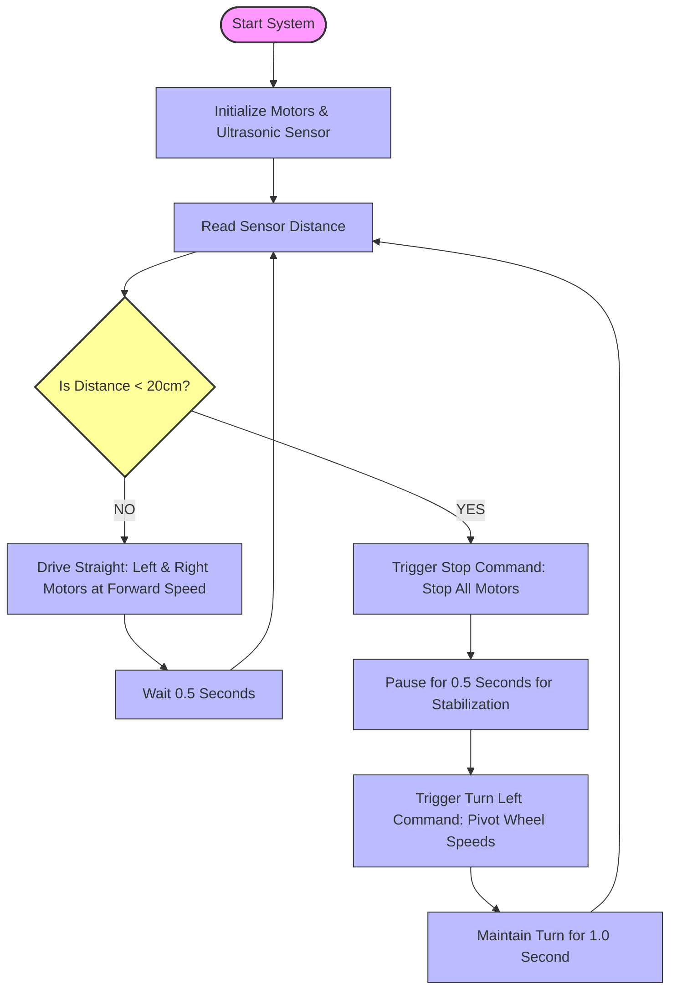

# deva.rover.system
Object-oriented Python controller for an autonomous obstacle-avoiding robot rover, featuring hardware abstraction layers compatible with Raspberry Pi and Webots 3D simulations. 


# 🤖 Automatic Obstacle-Avoiding Robot Controller

An object-oriented, production-ready Python controller designed for an autonomous robotic rover. Built on the core principles of the robotics pipeline—**Sense, Think, Decide, and Act**—this software utilizes hardware abstraction, making it seamlessly compatible with both physical hardware (Raspberry Pi & HC-SR04) and 3D virtual simulators like Webots.

---

## 📊 System Architecture Overview

The flow diagram below represents the real-time decision-making matrix executed by the robot's brain to avoid obstacles and navigate autonomously:



---

## 🛠️ Software Structure

As the autonomous security features scale, the project follows a clean, modular object-oriented directory structure:

```text
robot_project/
│
├── sensors/            # Handles raw distance sensor feeds
│   └── ultrasonic.py
├── motors/             # Hardware abstraction layer for motor drivers
│   └── motor_controller.py
├── navigation/         # Core obstacle avoidance & routing logic
│   └── obstacle_avoidance.py
├── vision/             # Future expansion: OpenCV human detection
│   └── camera.py
├── config/             # Threshold configurations and pin mappings
│   └── settings.py
└── main.py             # Main entry point to boot the robot controller
```

---

## 🚀 Key Features

* **Hardware Abstraction:** The core decision logic (`class Robot`) remains completely independent of the environment, ensuring quick adaptation between simulation and real-world microcontrollers.
* **Sense-Think-Decide-Act Loop:** Continuous evaluation of sensor inputs with precise timing loops to minimize physical hardware strain.
* **Fail-Safe Mechanism:** Instant wheel stabilization and stop triggers upon detecting tight-boundary breaches.

---

## 📂 Source Code
The complete functional object-oriented script logic can be found directly in the [`deva.robotic.py`](./deva.robotic.py) file within this repository.
